# pic4D

**Photonic integrated circuits, animated in Blender.** pic4D turns a chip layout (GDS) into a
rendered film of light travelling through it: the simulated wave where a field exists,
pulses along the waveguides where it does not, coloured by wavelength.

<p align="center">
  <a href="https://github.com/su3co/pic4D/releases/download/v0.1.0/pic4D-showreel.mp4">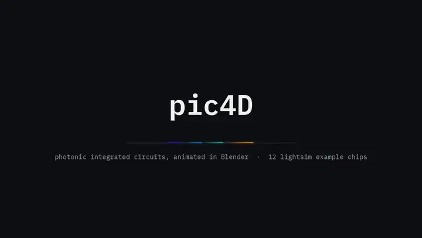</a>
  <br>
  <a href="https://github.com/su3co/pic4D/releases/download/v0.1.0/pic4D-showreel.mp4"><b>Watch the HD showreel</b></a> (1080p MP4) · twelve example chips of <a href="https://developer.su3labs.com/lightsim/">lightsim</a>, one after the other
</p>

```sh
pic4d render chip.toml -o out/ --style dark --size 1920x1080 --seconds 7 --mp4 chip.mp4 --label
```

| | |
|---|---|
| **Input** | a GDS file (or a gdsfactory component) and a layer stack; optionally a simulated field (complex phasor on a plane, one or more wavelengths) |
| **Light** | *field-driven*: Re[E e^(−iωt)], the simulated wave seen travelling, inside the guides and as a glow above the chip · *path-driven*: pulses along the waveguide centre lines from the input, splitting at junctions and couplers, for any layout |
| **Colour** | a documented wavelength → colour rule from the visible to the telecom bands: 1271, 1291, 1311 and 1331 nm are violet, blue, azure and cyan; 1550 nm is orange |
| **Styles** | `white` (white studio, ground exactly #ffffff for a light page), `dark` (ground exactly #0c0e12 for a dark page), `black` (bloom), `blueprint`, `terminal` (light-on-dark technical look, with an optional ASCII redraw of every frame); styles are small JSON files |
| **Camera** | automatic framing from the layout; slow orbit (loops), turntable, top-down to perspective, fly-along the light path, push-in |
| **Output** | PNG sequences, H.264 MP4 (yuv420p, faststart) with burnt-in labels, posters, showreels with cross-fades, GIF/WebP previews |

### Site clips in two styles

Each example also has a 1440 × 1080 loop on a pure white ground (`white`) and on #0c0e12 (`dark`), made for the light and dark themes of the example pages; click a still to open the example's report.

<p align="center">
<a href="https://developer.su3labs.com/lightsim/examples/q1-gbs/">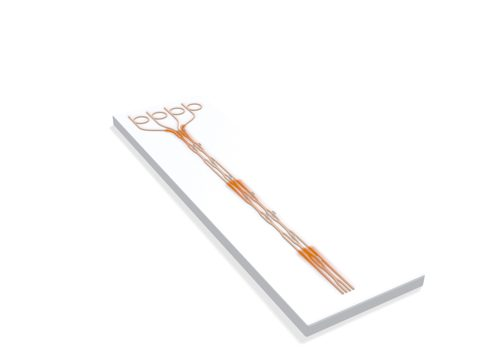</a>
<a href="https://developer.su3labs.com/lightsim/examples/q2-fusion/">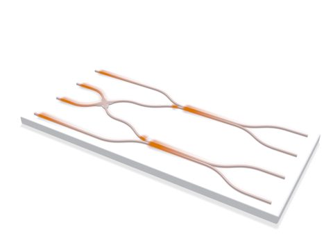</a>
<a href="https://developer.su3labs.com/lightsim/examples/q3-quantum-walk/">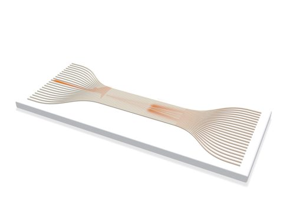</a>
<a href="https://developer.su3labs.com/lightsim/examples/q5-resonator-chip/">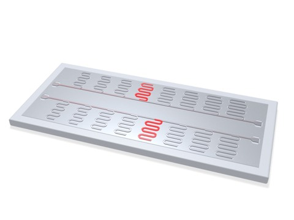</a>
<a href="https://developer.su3labs.com/lightsim/examples/s1-raman/">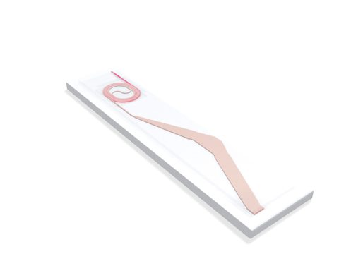</a>
<a href="https://developer.su3labs.com/lightsim/examples/s2-ring-sensor/">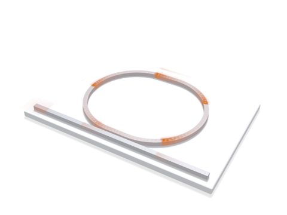</a>
<a href="https://developer.su3labs.com/lightsim/examples/s3-sers/">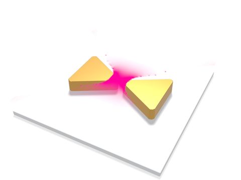</a>
<a href="https://developer.su3labs.com/lightsim/examples/d1-mzm/">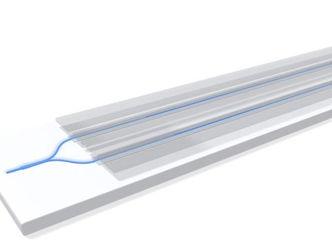</a>
<a href="https://developer.su3labs.com/lightsim/examples/d2-cwdm4/">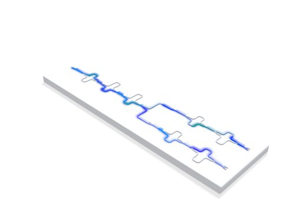</a>
<a href="https://developer.su3labs.com/lightsim/examples/d3-grating-coupler/">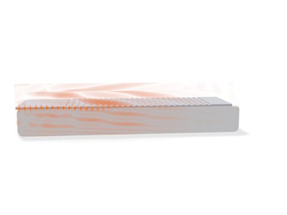</a>
<a href="https://developer.su3labs.com/lightsim/examples/i1-matmul/">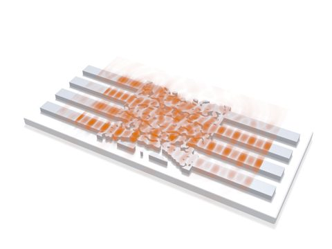</a>
<a href="https://developer.su3labs.com/lightsim/examples/i2-duplexer/">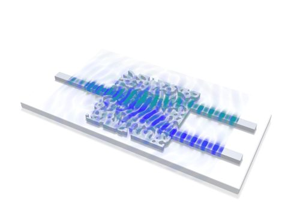</a>
<a href="https://developer.su3labs.com/lightsim/examples/i3-receiver/">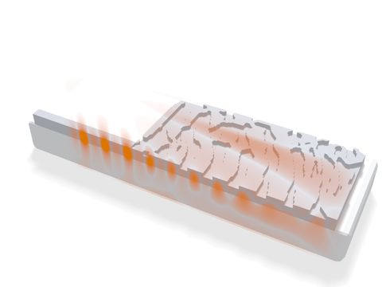</a>
</p>

<p align="center">
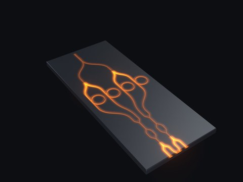
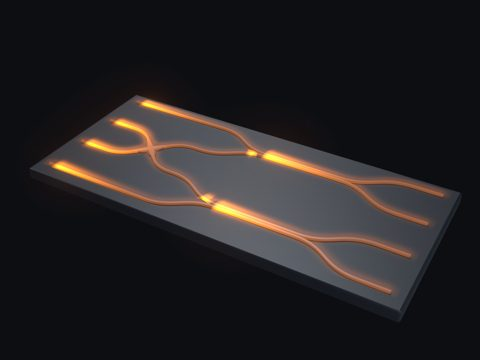
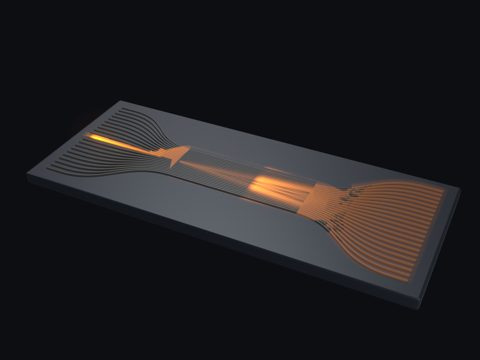
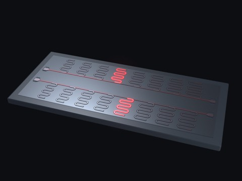
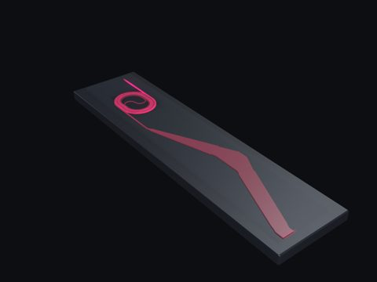
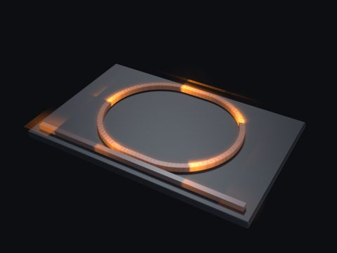
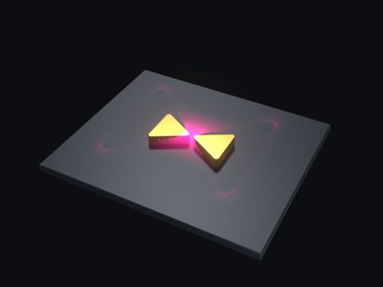
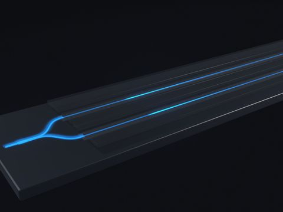
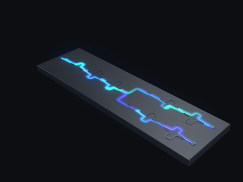
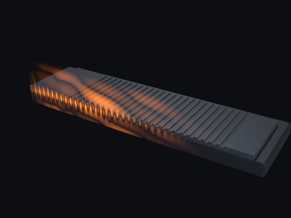
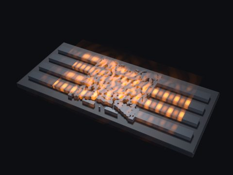
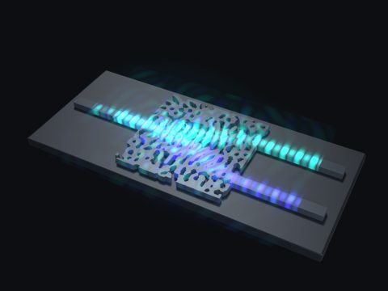
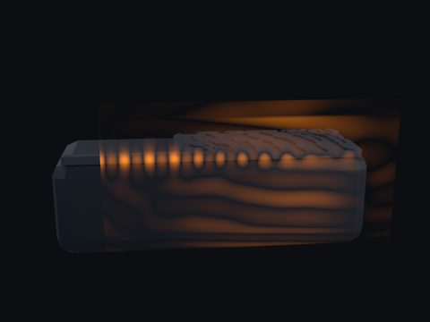
</p>


## Install

pic4D has two halves. The **prepare** step (GDS import, light paths, field textures) is
plain Python; the **render** step runs inside [Blender](https://www.blender.org) 4.2 or later
(tested with 5.1 and 5.2) and needs nothing but the numpy Blender ships with.

```sh
git clone https://github.com/su3co/pic4D && cd pic4D
pip install -e .            # numpy, scipy, scikit-image, gdstk, pillow
export PIC4D_BLENDER=/path/to/blender
pytest -q                   # fast tests, no Blender needed
```

`ffmpeg` must be on the PATH for MP4 output.

## Use

A scene file says what to read and how to show it ([`examples/demo/scene.toml`](examples/demo/scene.toml)):

```toml
name = "Demo: MMI splitter and ring"
subtitle = "SOI 220 nm · 1550 nm"
gds = "demo.gds"

[[layer]]
gds = [1, 0]          # GDS layer and datatype
zmin = 0.0            # um
zmax = 0.22
material = "si"       # si, sin, sio2, metal, au, heater, water, ...
role = "core"         # core layers guide light; "solid" and "clad" layers are drawn as is

[light]
mode = "path"         # or "field" (with field = "field.npz") or "intensity"
wavelength_nm = [1550]
source = [0.3, 0.0]   # input port; `pic4d ports demo.gds` lists the free ends

[camera]
move = "orbit"
azimuth = -60
elevation = 35
```

```sh
pic4d prepare examples/demo/scene.toml bundle/        # GDS -> bundle (inspect scene.json)
pic4d render examples/demo/scene.toml -o out/ --style white --size 1440x1080 --frames 1-30
pic4d encode out/frames demo.mp4 --title "MMI splitter" --subtitle "SOI · 1550 nm" --swatch "#ff8900"
pic4d showreel a.mp4 b.mp4 c.mp4 -o reel.mp4 --title-card
pic4d preview reel.mp4 reel.gif
pic4d colors 1271 1311 1550 785                       # display colours
pic4d styles
```

`pic4d render` calls `blender -b --factory-startup -P pic4d/blender/run.py -- ...`; render
long clips in chunks with `--frames 1-60`, `61-120`, and so on. `--save-blend scene.blend`
keeps the animated scene; installing the `pic4d` folder as a Blender add-on adds
*File > Import > pic4D bundle* to open a prepared bundle in the UI.

### Several wavelengths, routing

`wavelength_nm = [1271, 1291, 1311, 1331]` sends interleaved pulses of four colours. With
`routes` (one list of output points per wavelength) a colour is drawn only on the guides
that lead to its outputs, so a demultiplexer separates its channels on screen. Several
inputs lit at once: `source = [[x1, y1], [x2, y2]]`.

### Scene file reference

| key | meaning |
|---|---|
| `name`, `subtitle` | label text (device name; platform and wavelength) |
| `gds`, `cell` | layout file and cell (default: the cell named like the file, else the largest top cell) |
| `frame` | `[xmin, ymin, xmax, ymax]` um: frame this region instead of the whole layout |
| `[[layer]]` | `gds`, `zmin`, `zmax`, `material`, `role` (`core`, `solid`, `clad`), `name`, `opacity` |
| `[cladding]`, `[substrate]` | translucent cladding slab; die block (`material`, `margin_um`, `thickness_frac`) |
| `[display]` | `widen_um`, `z_scale`, `relief`, `crop_to_frame` (cut the die out at the frame) |
| `[light]` | `mode` (`path`, `field`, `intensity`), `wavelength_nm`, `source`, `routes`, `coupling_gap_um`, `pulses`, `pulses_per_loop`, `weight`, `field`, `cycles`, `sequence`, `percentile`, `caption`, `plane_z_um`, `plane_fade` |
| `[camera]` | `move`, `azimuth`, `elevation`, `amplitude`, `lens_mm`, `zoom`, `margin`, `target_um` |
| `[style_overrides.<style>.light]` | per-scene tweaks of a style, e.g. `field_gamma = 0.5` |

### Simulated fields

A field file is a `.npz` with

| key | | |
|---|---|---|
| `E` | complex, `(n, nu, nv)` or `(nu, nv)` | phasor of each entry |
| `u`, `v` | float, um | sample coordinates along the plane's two axes |
| `wavelength_nm` | float, `(n,)` | vacuum wavelength of each entry |
| `plane` | `"xy"`, `"xz"` or `"yz"` | which layout axes `u` and `v` are |
| `offset_um` | float | position of the plane on the third axis |
| `label` | str, `(n,)` | optional |

Coordinates are those of the layout (z = 0 at the bottom of the core film).
`pic4d.field.save_field` writes one. An `xy` field lights the guides and a glow above the
chip; an `xz` field is drawn on a cut through the chip (the front half is cut away).
Entries of different wavelengths are shown together in their colours; with
`sequence = true` they are shown one after the other with cross-fades (loops). An
intensity map |E|² has lost its phase and cannot travel: use it as `weight` (brightness of
a path-driven animation) or with `mode = "intensity"`.

`[light] plane_z_um = [zlo, zhi]` keeps only that height range of a vertical (`xz`, `yz`)
field plane, so the die block need not reach as deep as the simulation does;
`plane_fade = f` or `[sides, top, bottom]` fades a field plane out over that fraction of its
size towards its edges instead of ending it in a hard rectangle (it only dims the simulated
field). The `d3` and `i3` scenes use both to stand their cross-section on the centre line of
a flat, cut chip seen from above.

### Scale and legibility

A 0.4 um wire on a millimetre die is far below a pixel, and a 220 nm film is flat at any
reasonable zoom. pic4D widens core features to at least about 5 px of the frame and
exaggerates the vertical scale so that the core film stands about as tall as the displayed
wire is wide. Both factors are chosen automatically, can be fixed in the scene file
(`[display] widen_um`, `z_scale`), and are written to `scene.json` and to every render's
`render_*.json` under `legibility`, because they depart from the true geometry.

### Wavelength colours

Visible light gets its spectral hue (Bruton's piecewise approximation in sRGB). Telecom
wavelengths (1260–1675 nm) are mapped to a display wavelength by a fixed table that gives
the O band, where CWDM channels sit 20 nm apart, more of the spectrum; the near infrared
between them is drawn on the line of purples, so the hue wheel closes. See
[`pic4d/colors.py`](pic4d/colors.py).

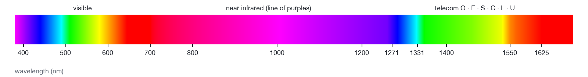

`pic4d colors 785 1271 1331 1550` prints the colours (#ff0074, #3f00ff, #00ffe7, #ff8900).

### Styles

Styles are JSON presets in [`pic4d/styles/`](pic4d/styles): background, ground, lights,
colour transform, bloom, the look of every material, how light is drawn and the label ink.
Pass a path to use your own; `"extends": "dark"` changes only what you set. The `white` and
`dark` grounds render as exact page colours; `pic4d.video.encode(..., snap=("#ffffff", 3))`
removes the last level or two of render noise so a clip sits seamlessly on its page.
`pic4d encode frames/ clip.mp4 --ascii` redraws every frame as coloured monospace characters.

## The lightsim example chips

[`showcase/lightsim/`](showcase/lightsim) holds the scene files, layouts and field samples of
the example chips of [lightsim](https://github.com/su3co/lightsim), the open
electromagnetic solver whose documentation and example reports are at
[developer.su3labs.com/lightsim](https://developer.su3labs.com/lightsim/). The fields come from those
simulations; `showcase/lightsim/convert.py` turns a lightsim result into pic4D's format.

| example | chip | wavelength | light |
|---|---|---|---|
| [`q1-gbs`](https://developer.su3labs.com/lightsim/examples/q1-gbs/) | Gaussian boson sampler | 1554.9 nm | path-driven |
| [`q2-fusion`](https://developer.su3labs.com/lightsim/examples/q2-fusion/) | Type-II fusion circuit | 1550 nm | simulated \|E\|², pulsing illustrative |
| [`q3-quantum-walk`](https://developer.su3labs.com/lightsim/examples/q3-quantum-walk/) | Quantum walk in 21 coupled waveguides | 1550 nm | path-driven, brightness from simulated \|E\|² |
| [`q5-resonator-chip`](https://developer.su3labs.com/lightsim/examples/q5-resonator-chip/) | Superconducting resonator chip (microwave) | 5.9–8.4 GHz | field sequence: circuit-model voltage at each resonance, not a field solve |
| [`s1-raman`](https://developer.su3labs.com/lightsim/examples/s1-raman/) | Waveguide-enhanced Raman chip | 785 nm | path-driven |
| [`s2-ring-sensor`](https://developer.su3labs.com/lightsim/examples/s2-ring-sensor/) | Racetrack ring sensor | 1550 nm | path-driven, brightness from simulated \|E\|² |
| [`s3-sers`](https://developer.su3labs.com/lightsim/examples/s3-sers/) | Gold bowtie for SERS | 847 nm | simulated \|E\|², pulsing illustrative |
| [`d1-mzm`](https://developer.su3labs.com/lightsim/examples/d1-mzm/) | Mach–Zehnder modulator | 1310 nm | path-driven |
| [`d2-cwdm4`](https://developer.su3labs.com/lightsim/examples/d2-cwdm4/) | CWDM4 demultiplexer | 1271 / 1291 / 1311 / 1331 nm | path-driven |
| [`d3-grating-coupler`](https://developer.su3labs.com/lightsim/examples/d3-grating-coupler/) | Grating coupler | 1552.5 nm | field-driven (simulated phasor) |
| [`i1-matmul`](https://developer.su3labs.com/lightsim/examples/i1-matmul/) | 4 × 4 DFT matrix multiplier | 1550 nm | field-driven (simulated phasor) |
| [`i2-duplexer`](https://developer.su3labs.com/lightsim/examples/i2-duplexer/) | 1271 / 1331 nm duplexer | 1271 / 1331 nm | field-driven (simulated phasor) |
| [`i3-receiver`](https://developer.su3labs.com/lightsim/examples/i3-receiver/) | Free-space receiver | 1550 nm | field-driven (simulated phasor) |
| [`i4-matmul-scaling`](https://developer.su3labs.com/lightsim/examples/i4-matmul-scaling/) | 8 × 8 unitary matrix multiplier | 1550 nm | field-driven (simulated phasor) |

*Field-driven* clips show the simulated phasor (Re E e^(−iωt)) from the lightsim run; *path-driven* clips are
illustrations of where light goes, computed from the layout alone, and are captioned as such. Where the
example has a simulated intensity map, it sets the brightness of the guides (q3, s2) or is shown directly
(q2, s3). Scales: wires on the large dies are widened and the films drawn thicker (up to 17 × on the 2 mm Raman chip); every bundle's
`scene.json` says by how much. The d1 clip frames the first 250 µm of the 3.1 mm modulator; d3 is a cut-out of
the grating end of the coupler.

## How it works

1. **prepare** (`pic4d/bundle.py`): read the GDS with gdstk, union and widen each layer,
   choose the scale; for path-driven light rasterise the cores, close coupler gaps, thin to
   centre lines, run Dijkstra from the input (`pic4d/paths.py`) and store the arrival
   distance of every pixel; for field-driven light resample and normalise the phasors.
2. **build** (`pic4d/blender/build.py`, inside Blender): extrude the layers into bevelled
   meshes, add substrate, ground, world and lights from the style, and write the light as
   shader graphs that read the textures and an animated clock, so the same .blend plays
   back in the UI; per-frame camera keys come from `pic4d/camera.py`.
3. **render** with EEVEE (a 1440 × 1080 frame takes about a second), then **encode** with
   ffmpeg, burning labels in with Pillow.

## Licence

MIT, see [LICENSE](LICENSE).
